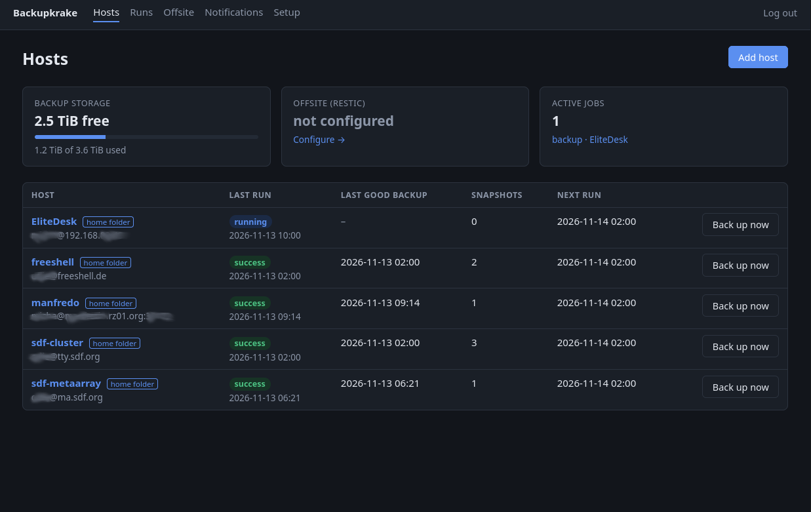
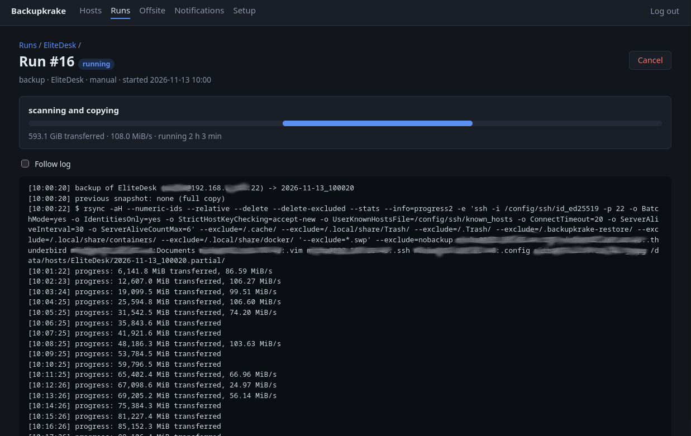
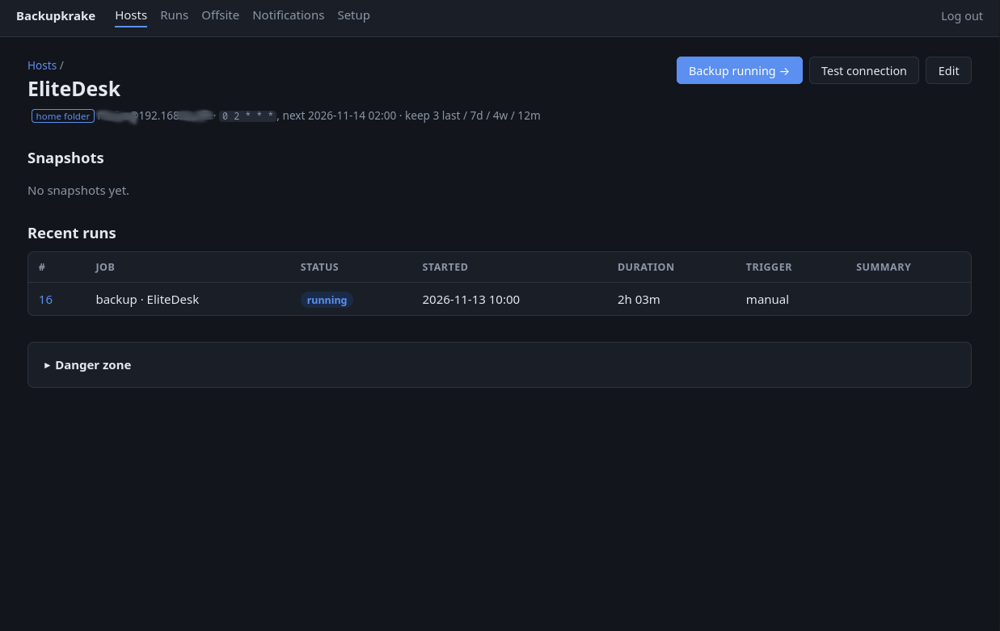
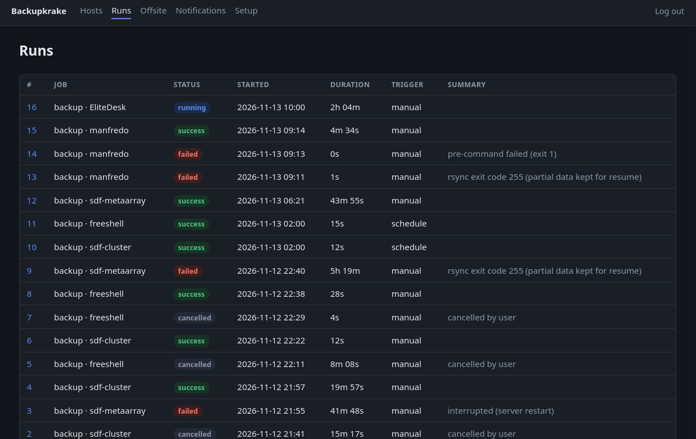

# Backupkrake

[](https://github.com/DK1MI/backupkrake/actions/workflows/ci.yml)

**DISCLAIMER: USE AT YOUR OWN RISK! I WILL NOT BE RESPONSIBLE FOR ANY DATA LOSS! TEST THE SOFTWARE BEFORE USING IT!**

Backupkrake is a central, pull-based backup server for Linux/Unix hosts with a web interface.

- **Pull over SSH**: the server connects to each client as `root` and copies files with `rsync`. Clients need only `rsync` and the server's public key, no agent.
- **Non-root hosts**: back up just your home folder on systems where you only have a normal account (e.g. shared Unix systems), with a key locked to that folder.
- **Hardlinked snapshots**: every snapshot is a complete, browsable directory tree. Unchanged files are hardlinked to the previous snapshot, so each new snapshot only uses space for changed files.
- **Backup windows & bandwidth limits**: per host, e.g. only between 22:00 and 06:00 at max 20 MiB/s; a backup still running when the window closes is stopped and resumes the next night.
- **Retention**: keep the last N snapshots plus N daily, weekly and monthly ones, applied after every backup.
- **Push-restore**: put files or folders from any snapshot back onto a client (staging dir, original location or another folder, even on another host), with a dry-run preview first.
- **Notifications**: ntfy and/or Pushover push messages when a backup fails or a host has had no successful backup for N days (optionally also warnings, offsite/restore failures, and "OK again"). An optional hourly heartbeat to healthchecks.io/Uptime Kuma covers the server itself being down.
- **Web UI**: manage hosts, cron schedules, live logs with a progress bar (files checked, data transferred, speed, time left), run history and a snapshot browser with file and `.tar.gz` downloads.
- **Encrypted offsite copy**: restic uploads the latest snapshot of every host to S3, B2, SFTP, a rest-server, etc., with its own retention policy and a restore option.

## Screenshots

Overview of all configured hosts:



Monitoring of an active backup run:



Detail view of one host and its executed runs:



Overview of all runs so far:




## Deploy with Docker Compose

Prebuilt images for **amd64 and arm64** (e.g. Raspberry Pi 4/5, ARM NAS) are published to `ghcr.io/dk1mi/backupkrake`. You don't need to clone this repository to run it.

### 1. Create a directory and a compose file

```sh
mkdir -p /opt/backupkrake && cd /opt/backupkrake
```

Create `docker-compose.yml`:

```yaml
services:
  backupkrake:
    image: ghcr.io/dk1mi/backupkrake:0.1.0     # or :latest to follow main
    container_name: backupkrake
    restart: unless-stopped
    ports:
      - "8080:8080"                           # e.g. "192.168.1.5:8080:8080" to bind to one LAN address
    environment:
      TZ: Europe/Berlin                       # schedules and snapshot names use this timezone
      BACKUPKRAKE_ADMIN_USER: admin
      BACKUPKRAKE_ADMIN_PASSWORD: ${BACKUPKRAKE_ADMIN_PASSWORD:?set it in .env}
      BACKUPKRAKE_MAX_PARALLEL: "2"           # host backups running at the same time
    volumes:
      - /srv/backups:/data                    # snapshots: point this at your big disk
      - ./config:/config                      # database, SSH keys, logs, restic cache
```

Put the admin password in a `.env` file next to it, so it isn't in the compose file:

```sh
printf 'BACKUPKRAKE_ADMIN_PASSWORD=%s\n' "$(openssl rand -base64 18)" > .env
chmod 600 .env
cat .env      # note the password
```

**Choosing the data location:**
- The `/data` volume must be on a local filesystem that supports hardlinks: ext4, xfs, btrfs or zfs. NFS/SMB shares from another machine won't work.
- Unchanged files are hardlinked between snapshots, so the space needed is roughly the size of all clients' data plus what changes within your retention period.

### 2. Start it

```sh
docker compose pull
docker compose up -d
docker compose logs -f      # Ctrl+C to stop following
```

Open `http://<server>:8080` and log in as `admin` with the password from `.env`. On first start the server creates its SSH keys in `config/ssh/`; the **Setup** page shows the lines to put on your clients (see [Adding a client](#adding-a-client)).

The container runs as root on purpose. Storing the clients' file ownership (uid/gid) requires it.

### 3. Updating

```sh
cd /opt/backupkrake
# when pinned: change the version in docker-compose.yml first, e.g. 0.1.0 -> 0.2.0
docker compose pull
docker compose up -d
```

Database changes are applied automatically on start. Running backups are interrupted by the restart; their partial data is kept and the next run resumes. To roll back, set the previous version and run `docker compose up -d` again.

Available image tags:

| Tag | Meaning |
|-----|---------|
| `0.1.0`, `0.1` | Released versions (from `v0.1.0` git tags). Recommended. |
| `latest` | Current `main` branch |
| `sha-<commit>` | A specific commit |

### 4. Disaster recovery

`config/` holds what makes this installation work:
- the SSH keys your clients trust
- the database: hosts, schedules, settings, and the offsite repository and password

With **Offsite → "Also upload Backupkrake's own configuration"** (on by default), every offsite run also uploads a consistent copy of it as a separate restic snapshot. It shows up as *Backupkrake configuration* in the offsite snapshot list.

**Keep the restic repository URL, its password and any backend credentials outside this server** (e.g. in a password manager). They are stored in the database, but you need them to get the database back.

If the server is lost, on the new machine:

```sh
mkdir -p /opt/backupkrake && cd /opt/backupkrake
# 1. recreate docker-compose.yml and .env as in step 1 (a new admin password is fine)

# 2. restore the configuration with the restic inside the image
docker run --rm \
  -e RESTIC_REPOSITORY='s3:https://…/bucket/backupkrake' -e RESTIC_PASSWORD='…' \
  -e AWS_ACCESS_KEY_ID='…' -e AWS_SECRET_ACCESS_KEY='…' \
  -v "$PWD/config:/restore" --entrypoint restic ghcr.io/dk1mi/backupkrake:0.1.0 \
  restore latest --host _backupkrake-config --target /restore

# 3. start: hosts, schedules, keys and settings are back
docker compose up -d
```

The clients still trust the restored SSH keys, so the next scheduled backups simply run. The first one copies everything again, because the local snapshot history is gone. To get files back that only exist offsite, use **Offsite → Offsite snapshots → Restore to server**, or `restic restore <id> --target …` as above.

If you don't use offsite backups, keep a copy of `config/` some other way:

```sh
tar czf backupkrake-config-$(date +%F).tar.gz -C /opt/backupkrake config .env docker-compose.yml
```

### Network access

- The web UI is plain HTTP with a single admin login, which is fine on a home LAN. Don't forward port 8080 to the internet.
- For remote access, use a VPN (WireGuard, Tailscale), or a reverse proxy with HTTPS and extra authentication in front of it.

### Configuration reference

| Environment variable | Default | Meaning |
|---|---|---|
| `BACKUPKRAKE_ADMIN_USER` | `admin` | Web UI user |
| `BACKUPKRAKE_ADMIN_PASSWORD` | random | Web UI password. If unset, one is generated, printed to the log and stored in `config/initial_admin_password` |
| `BACKUPKRAKE_MAX_PARALLEL` | `2` | Host backups running at the same time |
| `TZ` | UTC | Timezone for schedules, backup windows and snapshot names |

| Volume | Contents |
|---|---|
| `/data` | `hosts/<name>/<YYYY-MM-DD_HHMMSS>/` snapshots, `restore/` (offsite restores) |
| `/config` | SQLite database, SSH keys, known_hosts, run logs, restic cache |

### Building the image yourself

The `docker-compose.yml` in this repository can also build from source:

```sh
git clone https://github.com/DK1MI/backupkrake.git && cd backupkrake
# edit docker-compose.yml (password, timezone, data path)
docker compose up -d --build
```

## Adding a client

1. Install `rsync` (≥ 3.2.4 ships `rrsync`) on the client.
2. Copy the line from the **Setup** page into `/root/.ssh/authorized_keys`:
   ```
   command="rrsync -ro /",restrict ssh-ed25519 AAAA... backupkrake
   ```
   This key can only *read* via rsync: no shell, no writes. Use the plain key without `command=` if you need pre/post commands such as database dumps.
3. Make sure `PermitRootLogin prohibit-password` is set in the client's `sshd_config`.
4. *Optional, for restores from the UI:* also add the restore key line from the **Setup** page:
   ```
   command="rrsync -wo /",restrict ssh-ed25519 AAAA... backupkrake-restore
   ```
   It's a separate key that can only *write*, so the backup key never needs write access.
5. Add the host in the UI and click **Test connection** (it checks both keys). The client's SSH host key is learned on first contact; a changed key will be rejected (use "Forget SSH host key" after a reinstall).

### Hosts where you aren't root (home folder only)

You can also back up just your own home folder on a system where you have a normal account, e.g. a shared Unix system or a university login. No root access is needed there.

1. Add the host and choose **Home folder only**. Enter your username; paths are relative to your home folder (`.` = all of it, `Documents` = just that folder), and excludes are anchored at the home folder (e.g. `/.cache/`).
2. On that system, add this line to **your** `~/.ssh/authorized_keys` (the exact line is shown in the form and on the Setup page):
   ```
   command="rrsync -ro .",restrict ssh-ed25519 AAAA... backupkrake
   ```
   `.` means your home folder, because ssh starts forced commands there, so the key can only read inside it. For restores, add the restore key with `rrsync -wo .` the same way.
3. **Test connection**, then back up.

Notes:
- **No `rrsync` there?** Copy the script to e.g. `~/bin/rrsync` (it needs `python3`) and use its full path in `command="…"`.
- **No Python either:** use the plain key line. Relative paths still resolve in your home folder; the key then has the same rights as your account.
- **Rootless containers:** Podman/Docker storage (`~/.local/share/containers/`, `~/.local/share/docker/`) is excluded by default. Its files belong to container sub-UIDs that your account can't read, and images can be pulled again. Back up important container volumes explicitly, e.g. with a pre-command `podman volume export`.
- **ACLs/xattrs** are off by default for these hosts, since many shared and non-Linux systems don't support them over rsync.
- **Restores** go to `~/.backupkrake-restore/…` by default (inside your home, invisible to other users), to the original place in your home, or to any folder relative to it.
- **Be a good neighbour:** respect the system's usage policy; a backup window and bandwidth limit keep the load low.

### Backup windows and bandwidth limits

Each host can have a **backup window** like `22:00-06:00` (may cross midnight; several ranges: `01:00-05:00, 13:00-14:00`) and a **bandwidth limit** like `20M` (MiB/s) or `500K`/`500` (KiB/s).

- Scheduled backups only start inside the window. One that would start outside it (e.g. because it waited for a free slot too long) is recorded as **skipped**.
- A backup still running when the window ends is stopped and recorded as **interrupted**. Its partial data is kept and the next run resumes from it, so a large first backup can be spread over several nights.
- **Back up now** ignores the window.
- The host form warns if the cron schedule fires outside the window.
- The bandwidth limit applies to backups from and restores to that host.
- The post-command always runs once the pre-command has run, even if the backup is cancelled, interrupted or fails.

Interrupted and skipped runs don't send failure notifications. If a host never manages to finish inside its window, the overdue alert reports it.

Configured paths that don't exist on a client (e.g. `/srv`) are skipped and noted in the run summary.

## Restoring

- **Push-restore from the UI**: browse a snapshot and click **Restore…** on a file or folder (or on a whole snapshot). Choose:
  - **Staging directory** (default): `/var/tmp/backupkrake-restore/<host>-<snapshot>/<path>` on the client; nothing existing is touched.
  - **Original location**: overwrites in place (requires an extra confirmation).
  - **Other directory**: the path is recreated below any folder you choose.

  The target can be any host, e.g. to move data to a replacement machine. Options: keep `*.bkrestore-<time>` copies of overwritten or deleted files (on by default), and *delete files not in the snapshot* to make a folder an exact copy. Paths excluded from backups are never deleted, and deleting isn't allowed for whole-snapshot restores.
  **Preview (dry run)** lists every change without writing anything; the preview's result page has a button to run the same restore for real.
- **Download**: browse a snapshot and download a file or a `.tar.gz` of a folder. A snapshot selector shows the same path in older snapshots.
- **Bulk restore from the Docker host**: snapshots are plain directories:
  ```sh
  rsync -aHAX --numeric-ids /path/to/data/hosts/web1/latest/etc/nginx/ root@web1:/etc/nginx/
  ```
  (this needs a key that's allowed to write, i.e. not the `rrsync -ro` one).
- **Disaster recovery**: *Offsite → Offsite snapshots → Restore to server* extracts a restic snapshot into `/data/restore/`. If the server itself is gone, any machine with `restic`, the repository URL and the password can restore.

## Offsite (restic)

On the **Offsite** page set the repository (e.g. `s3:https://…/bucket/path`, `b2:bucket:path`, `sftp:user@host:/path`), password and any credentials as environment lines. For `sftp:` repositories Backupkrake uses its own offsite SSH key (`config/ssh/id_ed25519_offsite`); the Offsite page shows the public key to add on the SFTP server, and the server's host key is learned on first contact. Use `sftp://user@host:PORT//path` for a non-standard port (Hetzner Storage Box: port 23, install the key with `install-ssh-key`). Click **Initialise repository** once, then **Run now** or enable the schedule. Schedule it after your host backups usually finish.

Only the latest local snapshot of each host is uploaded; restic keeps its own history (deduplicated). Each restic snapshot is tagged with its local snapshot name.

Unless disabled, each run also uploads Backupkrake's own configuration: a consistent copy of the database, the SSH keys, settings and logs, without the restic cache. It is stored under the restic host name `_backupkrake-config`, with the same retention. See [Disaster recovery](#4-disaster-recovery).

**Store the restic password somewhere other than this server.**

## Notifications

On the **Notifications** page enable ntfy (public ntfy.sh or your own server; topic plus optional token or user/password) and/or Pushover (user key plus an application token from pushover.net/apps/build). **Send test** checks the setup.

Failed host backups always notify. Optional:
- offsite failures and restore failures (both on by default)
- runs that finish with warnings
- a "Backup OK again" message on the first good run after a failure (on by default)

### Overdue backups

Independently of individual runs, an hourly check alerts when a host has had **no successful backup for N days** (default 2, set on the Notifications page; override per host in its settings, 0 = never). It reminds once a day while the problem persists, and sends "Backups up to date again" when it's resolved. Overdue hosts are also marked on the dashboard.

This catches what never produces a failed run: a disabled schedule, a stopped scheduler, or a server that was down. The first check runs about two minutes after startup.

### Heartbeat

Backupkrake can't tell you that it is itself down. For that, set a **heartbeat URL** (e.g. a [healthchecks.io](https://healthchecks.io) check with a 1-hour period, or an Uptime Kuma push monitor). Backupkrake fetches it every hour, and the external service alerts you when the pings stop.

### Message contents

Messages include the run summary and the last log lines. If you set the *Backupkrake URL*, tapping the notification opens the run. Delivery errors are logged and shown on the settings page; a broken notification service never affects backups.

## Development

```sh
python -m venv .venv && .venv/bin/pip install -r requirements-dev.txt
.venv/bin/pytest            # needs rsync, rrsync and restic installed locally
BACKUPKRAKE_DATA_DIR=./data BACKUPKRAKE_CONFIG_DIR=./config .venv/bin/uvicorn app.main:app --reload --port 8080
```

GitHub Actions (`.github/workflows/ci.yml`) runs the tests on every push and pull request. It then builds the Docker image, checks that the container starts, and pushes it for amd64 and arm64 (only on `main` and `v*` tags, not for pull requests).

The tests run real backups through a fake `ssh` (`tests/fakessh`) that invokes the actual `rrsync -ro` forced command, plus a real local restic repository.

## License

Apache License 2.0, see [LICENSE](LICENSE).
