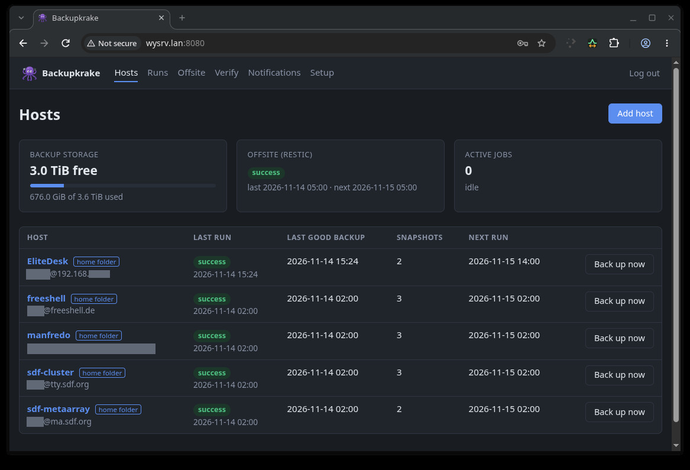

<p align="center"></p>

# Backupkrake

[](https://github.com/DK1MI/backupkrake/actions/workflows/ci.yml)

**DISCLAIMER: USE AT YOUR OWN RISK! I WILL NOT BE RESPONSIBLE FOR ANY DATA LOSS! TEST THE SOFTWARE BEFORE USING IT!**

**What's in the name?** *Krake* is German for octopus (and the root of the sea monster *Kraken*). Backupkrake is a backup octopus: it reaches out with many arms to all your machines, pulls their data in over SSH and keeps it safe in its den, with a copy hidden away offsite. The clients don't have to do anything; the octopus does the grabbing.

Backupkrake is a central, pull-based backup server for Linux/Unix hosts with a web interface.

- **Pull over SSH**: the server connects to each client as `root` and copies files with `rsync`. Clients need only `rsync` and the server's public key, no agent.
- **Non-root hosts**: back up just your home folder on systems where you only have a normal account (e.g. shared Unix systems), with a key locked to that folder.
- **Hardlinked snapshots**: every snapshot is a complete, browsable directory tree. Unchanged files are hardlinked to the previous snapshot, so each new snapshot only uses space for changed files. See [Snapshots and retention](https://dk1mi.github.io/backupkrake/snapshots/).
- **Backup windows & bandwidth limits**: per host, e.g. only between 22:00 and 06:00 at max 20 MiB/s; a backup still running when the window closes is stopped and resumes the next night.
- **Retention**: keep the last N snapshots plus N daily, weekly and monthly ones, applied after every backup. Pin a snapshot (e.g. *before OS upgrade*) to keep it until you unpin it.
- **Push-restore**: put files or folders from any snapshot back onto a client (staging dir, original location or another folder, even on another host), with a dry-run preview first.
- **Backup verification**: every backup is compared with the previous one, and one that is suspiciously smaller (a disk that didn't mount, an empty volume) is flagged and reported. A content check compares a snapshot with the client file by file to find silent corruption. A scheduled offsite restore test reads back part of the restic repository and restores random files of every host, comparing them byte for byte with the local snapshots.
- **Notifications**: ntfy and/or Pushover push messages when a backup fails or a host has had no successful backup for N days, or when the backup storage runs low or is forecast to fill up (optionally also warnings, offsite/restore failures, and "OK again"). An optional hourly heartbeat to healthchecks.io/Uptime Kuma covers the server itself being down.
- **Web UI**: manage hosts, cron schedules, live logs with a progress bar (files checked, data transferred, speed, time left), run history and a snapshot browser with file and `.tar.gz` downloads.
- **Encrypted offsite copies**: restic uploads the latest snapshots to one or more targets (S3, B2, SFTP, a rest-server, a USB disk, …), each with its own schedule, upload window, host selection and retention, and a restore option.

**📖 Manual: [dk1mi.github.io/backupkrake](https://dk1mi.github.io/backupkrake/)** (source in [`docs/`](docs/))



## Quick start

Prebuilt images for **amd64 and arm64** are published to `ghcr.io/dk1mi/backupkrake`.

```sh
mkdir -p /opt/backupkrake && cd /opt/backupkrake
printf 'BACKUPKRAKE_ADMIN_PASSWORD=%s\n' "$(openssl rand -base64 18)" > .env && chmod 600 .env
```

`docker-compose.yml`:

```yaml
services:
  backupkrake:
    image: ghcr.io/dk1mi/backupkrake:0.6.0
    container_name: backupkrake
    restart: unless-stopped
    ports:
      - "8080:8080"
    environment:
      TZ: Europe/Berlin
      BACKUPKRAKE_ADMIN_PASSWORD: ${BACKUPKRAKE_ADMIN_PASSWORD:?set it in .env}
    volumes:
      - /srv/backups:/data          # snapshots: a local disk with hard-link support (ext4, XFS, btrfs, ZFS)
      - ./config:/config            # database, SSH keys, logs
```

```sh
docker compose up -d
```

Open `http://<server>:8080`, log in as `admin` with the password from `.env`, and follow the **Setup**
page: install `rsync` on a client, add the read-only key line to `/root/.ssh/authorized_keys`,
add the host and click **Test connection**.

Don't expose the web UI to the internet; use a VPN or a reverse proxy with extra authentication.

## Documentation

The [manual](https://dk1mi.github.io/backupkrake/) covers everything in detail:

- [Installation](https://dk1mi.github.io/backupkrake/installation/): storage planning, updating, HTTPS
- [Adding hosts](https://dk1mi.github.io/backupkrake/hosts/): SSH keys and rrsync, home-folder hosts, BSD
- [Configuring backups](https://dk1mi.github.io/backupkrake/backups/): paths, schedules, windows, retries, database presets
- [Snapshots and retention](https://dk1mi.github.io/backupkrake/snapshots/): how the hard-link snapshots work, pins, disk usage
- [Browsing, searching and restoring](https://dk1mi.github.io/backupkrake/restoring/)
- [Offsite copies](https://dk1mi.github.io/backupkrake/offsite/): restic targets, SFTP, USB disks
- [Verifying backups](https://dk1mi.github.io/backupkrake/verification/)
- [Notifications](https://dk1mi.github.io/backupkrake/notifications/): ntfy, Pushover, overdue and disk alerts, heartbeat
- [Operations](https://dk1mi.github.io/backupkrake/operations/): routine, **disaster recovery**, moving to a new disk, security
- [Troubleshooting](https://dk1mi.github.io/backupkrake/troubleshooting/) and [Reference](https://dk1mi.github.io/backupkrake/reference/)

## Development

```sh
python -m venv .venv && .venv/bin/pip install -r requirements-dev.txt
.venv/bin/pytest            # needs rsync, rrsync and restic installed locally
BACKUPKRAKE_DATA_DIR=./data BACKUPKRAKE_CONFIG_DIR=./config .venv/bin/uvicorn app.main:app --reload --port 8080
```

The manual is built with MkDocs Material:

```sh
python -m venv .venv-docs && .venv-docs/bin/pip install -r requirements-docs.txt
.venv-docs/bin/mkdocs serve      # http://127.0.0.1:8000, reloads on changes
```

GitHub Actions runs the tests on every push and pull request, then builds the Docker image, checks that
the container starts, and pushes it for amd64 and arm64 (only on `main` and `v*` tags). A second workflow
builds the manual and publishes it to GitHub Pages.

The tests run real backups through a fake `ssh` (`tests/fakessh`) that invokes the actual `rrsync -ro`
forced command, plus a real local restic repository.

## License

Apache License 2.0, see [LICENSE](LICENSE).
