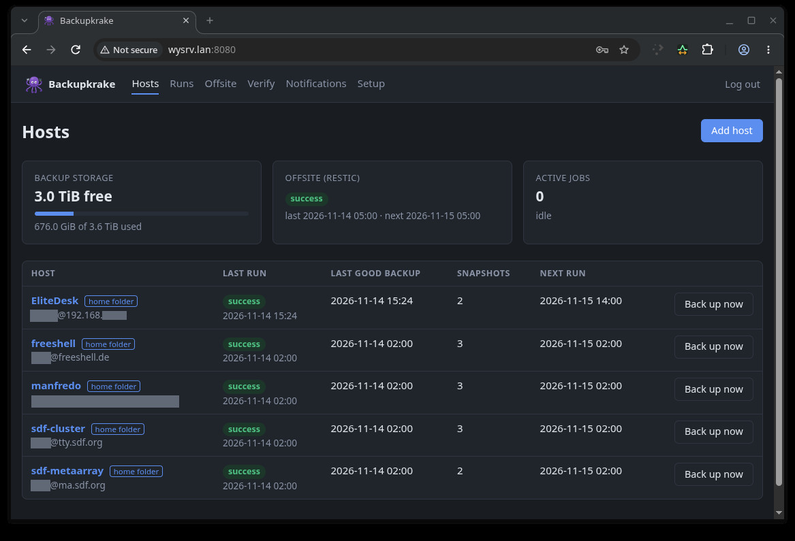

# Backupkrake

{ width="160" align=right }

Backupkrake is a central, pull-based backup server for Linux and Unix hosts, with a web interface. It runs as
a single Docker container. Each night it connects to your machines over SSH, copies their files with
`rsync` into browsable, hard-linked snapshots, and optionally uploads an encrypted copy offsite with `restic`.

!!! danger "Use at your own risk"
    Backupkrake comes without any warranty. Test it, and test your restores, before you rely on it.

## What's in the name?

*Krake* is German for octopus (and the root of the sea monster *Kraken*). Backupkrake is a backup octopus.
It reaches out with many arms to all your machines, pulls their data in and keeps it safe in its den, with
a copy hidden away offsite. The clients don't have to do anything; the octopus does the grabbing.

## How it works

```
               ┌──────── Backupkrake (Docker) ────────┐
  web1   ◄─ssh─┤ rsync pull ─► /data/hosts/web1/…     │
  nas    ◄─ssh─┤               /data/hosts/nas/…      ├─restic─► S3, SFTP,
  laptop ◄─ssh─┤ scheduler · web UI · notifications   │          USB disk
               └──────────────────────────────────────┘
```

- **Pull, not push.** The server holds the SSH keys and starts every backup. Clients run no agent and
  need nothing but `rsync` and one line in `authorized_keys`. A compromised client can't reach the server
  or delete its backups.
- **Read-only by default.** The backup key is locked to `rrsync -ro`: it can read files via rsync and
  nothing else. Restores use a second key that can only write.
- **Plain directories.** Every snapshot is a complete directory tree on the server's disk, laid out as on
  the client. Unchanged files are hard links to the previous snapshot, so a new snapshot only costs the
  space of what changed. You can read your backups with `ls` and `cp`, without Backupkrake.
- **Offsite with restic.** The latest snapshot of each host goes to one or more encrypted, deduplicated
  restic repositories: S3, B2, SFTP (e.g. a Hetzner Storage Box), a rest-server, or a USB disk.

## Features at a glance

| Area | What you get |
|---|---|
| Hosts | Whole systems as `root`, or just your home folder on machines where you aren't root |
| Scheduling | Cron schedules, backup windows (e.g. `22:00-06:00`), bandwidth limits, retries for laptops that are switched off |
| Consistency | Pre/post commands with presets for PostgreSQL, MySQL/MariaDB, SQLite and Docker |
| Retention | Last *N* plus daily/weekly/monthly snapshots; pinned snapshots with notes |
| Restoring | Browse and download, search a file across all snapshots, push-restore with a dry-run preview |
| Offsite | Multiple restic targets, each with its own hosts, schedule, window and retention |
| Verification | Plausibility check after every backup, content check against the client, offsite restore test |
| Monitoring | ntfy and Pushover notifications, overdue alerts, disk-space forecast, heartbeat for the server itself |



## Where to start

1. [Install](installation.md) the container.
2. [Add your first host](hosts.md) and run a backup.
3. [Configure](backups.md) schedules, windows and retention.
4. Set up [notifications](notifications.md) so you hear about failures.
5. Add an [offsite copy](offsite.md) and schedule a [restore test](verification.md#offsite-restore-test).
6. Read [Operations](operations.md) before you need it, especially *disaster recovery*.

## Getting help

Bugs and questions go to the [issue tracker](https://github.com/DK1MI/backupkrake/issues). Please
include the run log (the run's page shows it) and your Backupkrake version (the image tag).
